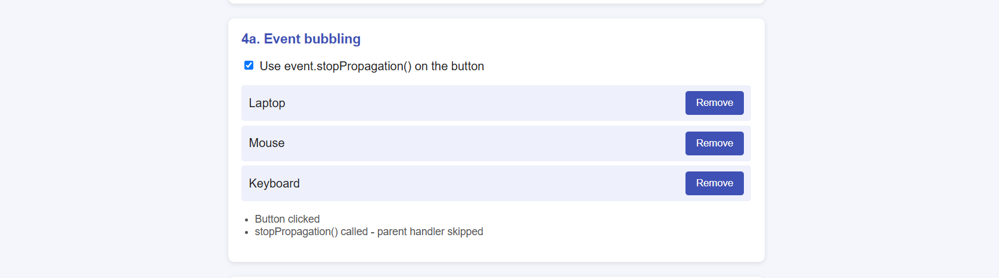

# QuickCart - Advanced JavaScript Practical Assignment

**Author:** Thota Adithya Vardhan

## Overview
QuickCart is an e-commerce order management system. In this assignment I fixed and
improved its code using modern JavaScript (ES6+): objects and classes, array methods,
Map/Set, JSON handling, asynchronous order flow, performance optimisation and DOM events.
No frameworks or external libraries are used.

## Technologies Used
- JavaScript (ES6+)
- HTML5 and CSS3 (Part E)
- Node.js (to run the console programs)
- Git and GitHub

## Project Structure
```
quickcart-advanced-javascript/
├── part-a-objects-classes/products.js
├── part-b-array-methods/shopping-cart.js
├── part-c-json-debugging/json-handling.js
├── part-d-asynchronous/order-processing.js
├── part-e-optimization-events/index.html, script.js, style.css
│   └── Screenshots/
│       ├── DEBOUNCED_SEARCH.png
│       ├── EVENT_BUBBLING.png
│       ├── EVENT_DELEGATION.png
│       ├── MEMORIZATION.png
│       └── THROTTLED_SCROLL.png
├── part-f-integration/quickcart.js
└── README.md
```

## How to Run
Parts A, B, C, D and F run with Node.js:
```bash
node part-a-objects-classes/products.js
node part-b-array-methods/shopping-cart.js
node part-c-json-debugging/json-handling.js
node part-d-asynchronous/order-processing.js
node part-f-integration/quickcart.js
```
Part E: open `part-e-optimization-events/index.html` in a browser (or use VS Code Live Server).

## Explanation of Each Part

**Part A - Objects, Prototypes & ES6 Classes**
Created a `Product` constructor with `displayProduct()` on the prototype so the method is
shared. Then built `Product`, `ElectronicProduct` and `ClothingProduct` classes using
`extends` and `super()`, and practised arrow functions, template literals, destructuring,
rest and spread in a checkout example.

**Part B - Array Methods, Map, Set & Object methods**
Used `map`, `filter`, `reduce` and `forEach` on the cart, a `Map` for inventory, a `Set` to
remove duplicate emails, and compared `Object.freeze()` with `Object.seal()`.

**Part C - JSON Handling**
Converted an order to JSON and back and noted which properties are lost (`undefined` and
functions). Predicted and verified the output of six JSON snippets, including errors.

**Part D - Asynchronous JavaScript**
Showed the event loop order (microtask before macrotask), then wrote the order flow with
callbacks, promises and async/await. Also tested `Promise.all`, `allSettled`, `race` and `any`
with three mock APIs.

**Part E - Optimization & DOM Events**
Debounced search (500 ms), throttled scroll (1000 ms), a memoized discount function that
logs cache hits, and event bubbling / delegation with a product list.

**Part F - Final Integration**
Order summary for Rahul combining a `Product` class, destructuring, `filter`, `map`,
`reduce`, `Set`, `Map`, `Object.freeze`, `JSON.stringify`, async/await with try/catch and
a template literal. All values are calculated, nothing is hardcoded.

## Screenshots
Part E screenshots are stored in the `part-e-optimization-events/Screenshots/` folder.

| Feature | Screenshot |
|---|---|
| Debounced search |  |
| Throttled scroll |  |
| Memoization |  |
| Event bubbling |  |
| Event delegation |  |

## Submission
- GitHub repository: https://github.com/Adithya3633/advanced-javascript-assignment
- Loom video: _(add your Loom link)_
- Live link: N.A
